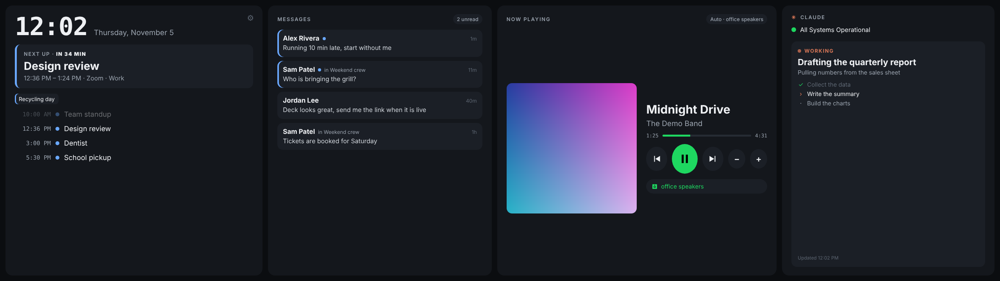
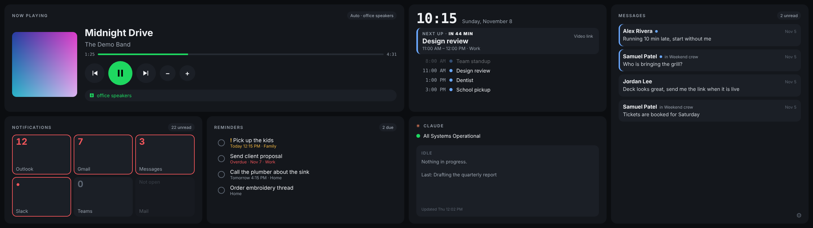

# Xeneon Edge Command Center

A full-width, touch-friendly dashboard for the **Corsair Xeneon Edge** (the 14.5" 2560×720 touchscreen) on a **Mac**.

Corsair's widget layer for the Edge only runs in iCUE on Windows. On a Mac the panel is just a second monitor. This project turns it into a glanceable command center:



| Panel | What it shows |
|---|---|
| **Calendar** | Clock, today's agenda from **Apple Calendar** (every calendar your Mac knows: iCloud, Google including calendars shared with you, Outlook/Exchange) and/or any number of calendar links (ICS), and a big "Next up / Now" card with a live countdown. Tap an event to open that day in Google Calendar, Outlook or Apple Calendar on your main screen. A **Join** button appears 15 minutes before any meeting with a Zoom, Teams, Meet or Webex link. |
| **Messages** | Your most recent incoming iMessages and texts, with names from Contacts (a contact's nickname is used when the card has one; settings let you show first names only, or type the exact name you want for anyone, which beats contact cards and names people share from their iPhones). Unread ones are marked, deleted ones drop off, and tapping one opens that conversation in Messages. |
| **Now Playing** | **Spotify** or **Apple Music**: album art, track, progress and big touch controls. Spotify can send playback to a chosen speaker (a Google Cast or Spotify Connect device) and keep it there. Apple Music is controlled directly on the Mac, with no account setup. |
| **Notifications** | Big tiles with the unread counts **Messages**, **Outlook**, **Mail**, **Slack**, **Teams** and other apps show on their Dock icons. No sign-ins: macOS already knows the numbers. Tap a tile to open the app. Choose which apps in settings. |
| **Reminders** | Your open **Apple Reminders** across all lists: flagged and overdue first, then today, then upcoming. Tap the circle to check one off; it syncs to your iPhone like any other change. |
| **AI assistant** | Live service status for **Claude**, **ChatGPT / OpenAI** or **GitHub Copilot**, plus a task card that shows what your assistant is working on. **Claude Code** and **Codex** can fill it automatically. |

**Pick what you see.** The Edge is divided into **8 zones**, four across the top and four across the bottom:

```
 ┌───┬───┬───┬───┐
 │ 1 │ 2 │ 3 │ 4 │
 ├───┼───┼───┼───┤
 │ 5 │ 6 │ 7 │ 8 │
 └───┴───┴───┴───┘
```

Choose a panel for each zone. Give a panel several zones to make it bigger: zones 1 and 2 make a wide block, 4 and 8 a tall column, 1, 2, 5 and 6 a big square. A panel's zones must form a rectangle, and settings show a live preview and flag anything that doesn't. Every panel has a compact version for half-height zones.



 Tap the ⚙︎ in the bottom-right corner of the Edge and settings open in your normal browser **on your main monitor**, where typing works properly. Save, and the Edge updates within a few seconds. (You can also open `http://127.0.0.1:8888/?settings` directly.)

Everything runs on your Mac. A small Python server listens only on `127.0.0.1`, and nothing is sent anywhere except the services you connect (Spotify, your calendar feeds, Claude's public status page).

## Requirements

- A Mac with macOS 13 or later
- A Corsair Xeneon Edge connected over USB-C (or any display; it works on any 2560×720 window)
- Google Chrome (the dashboard opens in its own app window)
- Python 3 from Apple's command-line tools. If it's missing, macOS offers to install it the first time you start the dashboard.
- Spotify Premium for playback control

## Install

1. Download this repository (**Code → Download ZIP**) and unzip it somewhere permanent, for example `~/Applications/Command Center`.
2. Double-click **Start Command Center.command**. If macOS blocks it, right-click it and choose **Open**.
3. The dashboard finds the Edge by itself and opens full screen on it, with no title bar. Esc doesn't exit, by design. To close it, click it and press **Command+Q**, or run **Stop Command Center**. Prefer a normal window? Untick *Full screen on the Edge* in settings and tap **Restart dashboard now**. (No Edge connected? It opens as a normal window you can drag anywhere.)
4. Tap the **⚙︎** in the bottom-right corner. Settings open on your main monitor: choose your panels and connect your accounts (below).

To start it automatically, add **Start Command Center.command** to *System Settings → General → Login Items*.

### Touch

macOS ignores the Edge's touch panel unless a driver is installed. Double-click **Install Touch Driver.command**. It downloads and builds [MacXeneonEdgeTouchDriver](https://github.com/ajvwhite/MacXeneonEdgeTouchDriver) (MIT) at a pinned, reviewed commit, with no admin password needed, then walks you through the two permissions it needs (*Accessibility* and *Input Monitoring*). It handles one finger at a time: taps and drags work, pinch doesn't.

### Calendars

**Easiest: Apple Calendar.** In settings, set *Calendar source* to **Apple Calendar on this Mac**. Every calendar your Mac's Calendar app shows comes through, including calendars other people share with you in Google (pick which ones sync at [calendar.google.com/calendar/syncselect](https://calendar.google.com/calendar/syncselect)) and work Exchange/Outlook calendars. Add accounts in *System Settings → Internet Accounts*, then untick any calendars you don't want on the Edge. The first time, *Start Command Center* builds a tiny helper (`cal-helper.swift`, using Apple's EventKit) and macOS asks for calendar access: click **Allow**. Tapping an event opens that day in Apple Calendar.

**Or: calendar links.** Each calendar needs its private ICS link. Paste it into the settings sheet, and add as many rows as you like.

- **Google Calendar:** on a computer, open Google Calendar → hover the calendar → **⋮ → Settings and sharing** → **Integrate calendar** → copy **Secret address in iCal format**. Google only shows this to a calendar's owner.
- **Outlook / Microsoft 365:** Outlook on the web → **Settings → Calendar → Shared calendars → Publish a calendar** → choose *Can view all details* → copy the **ICS** link. Some work accounts disable publishing.
- **iCloud:** Calendar app → right-click the calendar → **Share Calendar** → **Public Calendar** → copy the link.

Treat these links like passwords. They're stored in `config.json` next to the server, which is readable only by your user and excluded from git.

### Spotify

1. At [developer.spotify.com/dashboard](https://developer.spotify.com/dashboard), create an app.
2. Add the Redirect URI **`http://127.0.0.1:8888/callback`** exactly, and tick **Web API**.
3. Copy the app's **Client ID** into settings and save. Then tap **Sign in with Spotify** on the Edge itself (the sign-in has to happen in the dashboard window, since that's where its tokens are kept).

The dashboard uses Spotify's PKCE sign-in, so no client secret is needed. Tokens stay in that Chrome window's local storage.

**Preferred speaker:** enter its name exactly as Spotify shows it (for example `office speakers`). Pressing play when nothing is active starts music there. If music starts in the Spotify app on this Mac, it's moved to the speaker automatically, but playback on your phone or elsewhere is never touched. Tap the **Auto** pill to turn this off. Spotify only lists Cast speakers it has seen recently, so if yours isn't found, pick it once in the Spotify app.

### Apple Music

Choose **Apple Music** under *Music* in settings. The first time the dashboard reads the Music app, macOS asks whether Terminal may control Music. Click **OK**. (Missed it? *System Settings → Privacy & Security → Automation → Terminal →* turn on **Music**.)

### Notifications

Works for any app that shows a red count on its Dock icon, as long as the app is running. The dashboard reads the badges from the Dock itself, so the first time, allow Terminal under *System Settings → Privacy & Security → Accessibility*. Tick the apps you want in settings (it shows which are installed), or type any other app's name.

**Gmail:** the most reliable way is to add your Gmail account to Apple Mail (*Mail → Add Account → Google*) and turn on Mail's Dock unread count; the Mail tile then counts it. Each tile also has two optional settings: **Show as** (rename the tile, e.g. Mail → "Gmail") and **Tap opens** (an app name or an https:// link, opened in Chrome), so the Mail tile can open mail.google.com instead of Apple Mail. Alternatively, install the open-source [Gmail app badge notification](https://chromewebstore.google.com/detail/gmail-app-badge-notificat/fbaolhbfbmniffcokakochjjeccpcpkh) extension ([source](https://github.com/aberonni/gmail-app-badge-notification)) and install Gmail as a Chrome app (*⋮ → Cast, save and share → Install page as app*); this depends on Chrome putting a badge on the Dock icon, which doesn't happen on every setup. **LinkedIn:** the same "install as app" trick works only if LinkedIn sets a badge, which isn't guaranteed.

### Reminders

The first time, macOS asks whether Terminal may access Reminders. Click **Allow**. (Missed it? *System Settings → Privacy & Security → Reminders →* turn on **Terminal**.) The Reminders app is started hidden in the background if it isn't running.

### Messages

Messages history lives in a protected database. Give access once: *System Settings → Privacy & Security → Full Disk Access →* turn on **Terminal**, then run **Stop** and **Start** again. (The server starts from Terminal, so it inherits Terminal's permission.)

Heads up: the panel shows message text, including verification codes, to anyone who can see your desk.

## AI task card

The task card shows what your assistant is doing right now: the request, the last few steps ("Reading index.html", "Editing app.js", "Push the change to GitHub") and whether it is working, waiting on you, or done.

| Assistant | How it connects | What the card shows |
|---|---|---|
| **Claude Code** | Double-click **Connect AI Assistant.command**. It adds [hooks](https://code.claude.com/docs/en/hooks) to `~/.claude/settings.json` (backing it up first). | Live: your request, each step as it happens, *Waiting on you* when it needs approval, then *Done* with its closing line |
| **Codex CLI** | The same installer adds a `notify` line to `~/.codex/config.toml`. | When each turn finishes: *Done* with Codex's last reply. Codex only reports finished turns, so there is no live progress |
| **ChatGPT app / others** | No connection is possible: these apps don't report what they are doing. | Service status only. Turn the card off in settings |

The card never shows shell commands, file contents or tool output, since it sits on your desk in plain view. Steps are short descriptions only, and Claude Code's own command descriptions are used where available. It does show your request text.

### Writing the card yourself

Anything can drive the card by writing `claude-status.json` in the app folder: a script, a cron job, another tool. It's checked every 8 seconds. See `claude-status.example.json`:

```json
{
  "state": "working",
  "task": "Drafting the quarterly report",
  "detail": "Pulling numbers from the sales sheet",
  "steps": [
    { "label": "Collect the data", "state": "done" },
    { "label": "Write the summary", "state": "active" },
    { "label": "Build the charts", "state": "todo" }
  ],
  "updated": "2026-11-05T16:40:00Z"
}
```

`state` is one of `working`, `waiting` (needs you), `done` or `idle`. Cards older than two hours fall back to *Idle* automatically.

## How it works

- `server.py`: Python standard library only. It serves the page, fetches your ICS feeds server-side (calendar hosts don't allow browser cross-origin requests), reads `~/Library/Messages/chat.db` and your Contacts database read-only, and serves the status file. It binds to `127.0.0.1:8888`, rejects requests with any other `Host` header, and refuses write requests from other websites open in the browser (Origin, Fetch-Metadata and JSON content-type checks). Taps that open apps go through the server's `/api/open`, which only opens Messages conversations, calendar days for your configured feeds, and links on known video-meeting hosts.
- `index.html`: the whole UI in one file, with no build step. Calendars are parsed with [ical.js](https://github.com/kewisch/ical.js) (bundled as `ical.min.js`, MPL-2.0).
- `ai-status-hook.py`: the Claude Code hook / Codex notify program that writes the task card. Standard library only, never blocks the assistant, always exits 0.
- **Start / Stop Command Center.command**: start the server and open a dedicated Chrome app window (separate profile at `~/Library/Application Support/CommandCenterChrome`), or stop both.

Logs: `~/Library/Logs/CommandCenter.log`.

## Troubleshooting

| Problem | Fix |
|---|---|
| "Can't reach the local server" | Run **Start Command Center** again. Check the log above. |
| A calendar says "Couldn't load" | The link is wrong or not public. Google's *Public URL* only works for public calendars, so use the *Secret address*. |
| Messages asks for permission | Turn on Full Disk Access for Terminal, then Stop and Start. |
| Spotify "speaker isn't visible" | Choose the speaker once in the Spotify app, then tap the speaker chip on the dashboard. |
| Typing on the Edge doesn't work | Expected: full-screen windows, and the touch driver, hand the keyboard back to your main screen. Use the ⚙︎, which opens settings on the main monitor. |
| Apple Music says "Allow Terminal to control Music" | *System Settings → Privacy & Security → Automation → Terminal →* turn on **Music**. |
| The AI card never updates | Run **Connect AI Assistant**, then start a *new* Claude Code session (hooks load at startup). |
| Notification tiles all say 0 | Allow Terminal under *Privacy & Security → Accessibility*, then restart. A tile can only show what the app's Dock icon shows: if the icon has no red badge, neither will the tile. |
| Mail or Gmail tile says 0 with no Dock badge | The dashboard falls back to asking Mail for its unread count (allow Terminal to control Mail when macOS asks) and to reading the count in the Gmail window title ("Inbox (3)"). |
| Touch does nothing | Check both permissions for MacXeneonEdgeTouchDriver, then rerun **Install Touch Driver**. |

## Credits and license

MIT © Bushkill Consulting LLC. See [LICENSE](LICENSE).

- [ical.js](https://github.com/kewisch/ical.js) by Philipp Kewisch and contributors, MPL-2.0
- [MacXeneonEdgeTouchDriver](https://github.com/ajvwhite/MacXeneonEdgeTouchDriver) by ajvwhite, MIT (downloaded at install time, not bundled)

"Corsair" and "Xeneon" are trademarks of Corsair Gaming, Inc. Spotify is a trademark of Spotify AB. Claude is a trademark of Anthropic. This project is not affiliated with or endorsed by any of them. The names are used only to describe compatibility.
